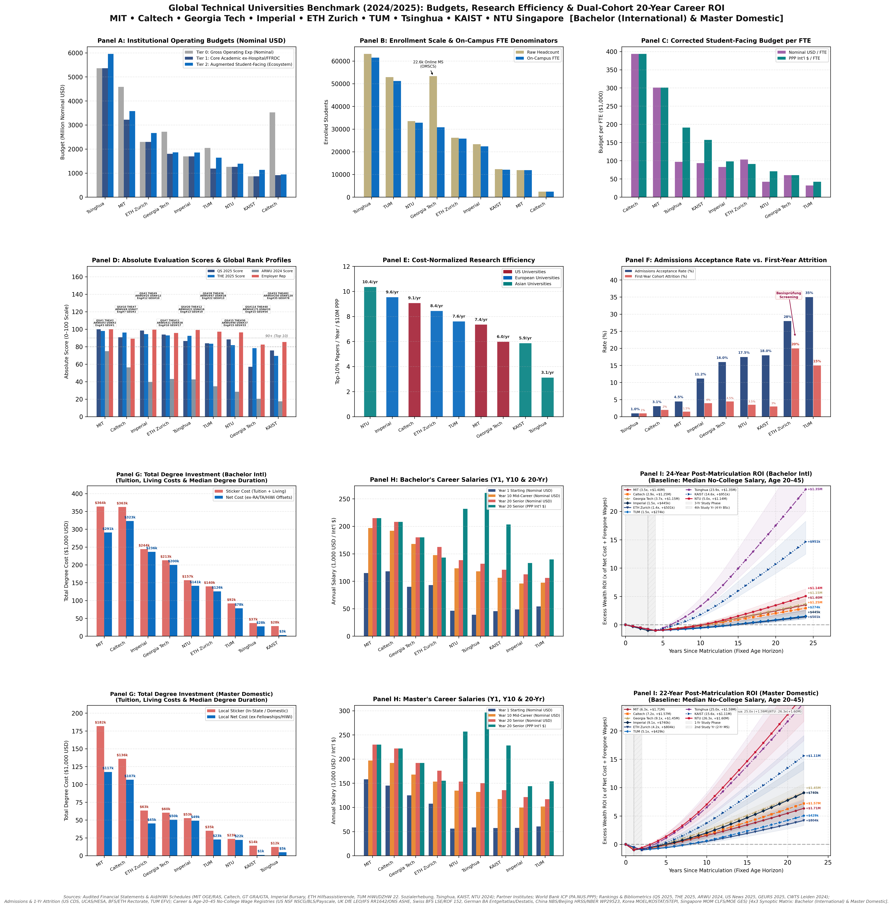
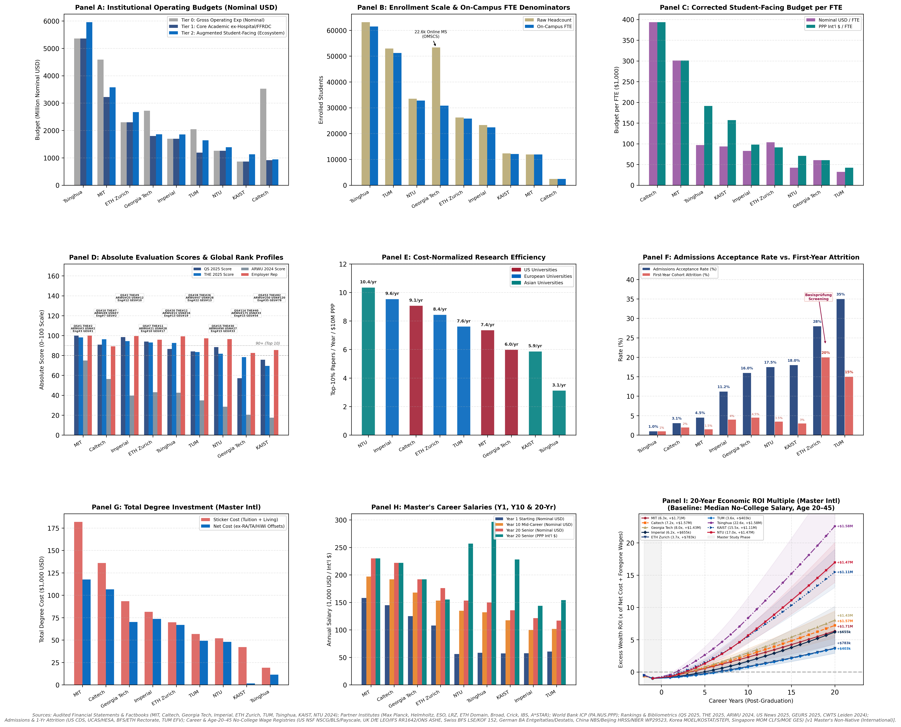
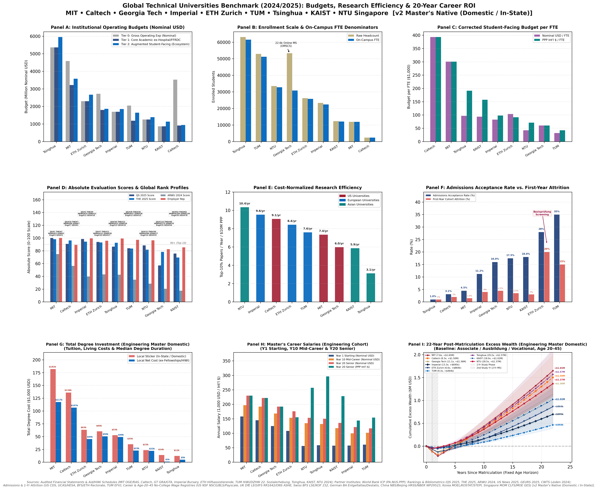
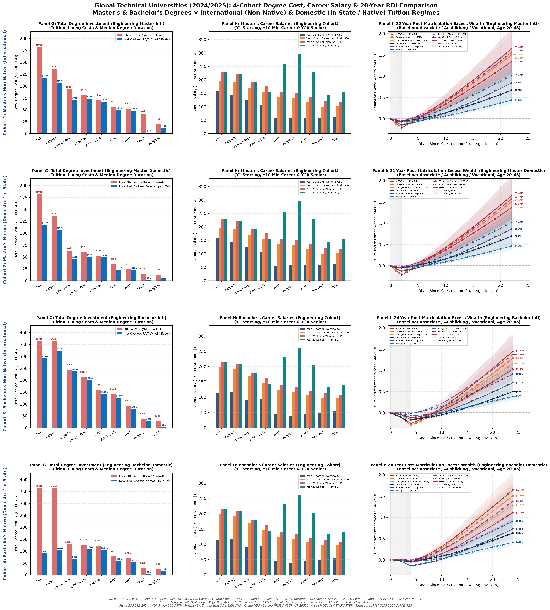

# Cross-Continental Comparative Analysis of 9 Elite Technical Universities
## United States vs. Europe vs. Asia ($3 \times 3$ Regional Matrix)

[](file:///Users/selle/Documents/GitHub/technical-universities/.agents/skills/responsible-research/scripts/audit_research_pipeline.py)
[](file:///Users/selle/Documents/GitHub/technical-universities/rawdata/MANIFEST.csv)
[](file:///Users/selle/Documents/GitHub/technical-universities/README.md)

This empirical research repository provides a rigorous, multi-dimensional descriptive and structural comparative analysis across **9 leading technical universities** spanning three continental regions ($3 \times 3$ regional matrix):

- **United States (`US`)**: **MIT**, **Caltech**, **Georgia Tech**
- **Europe (`EU`)**: **Imperial College London**, **ETH Zurich**, **TUM (Technical University of Munich)**
- **Asia (`ASIA`)**: **Tsinghua University**, **KAIST**, **NTU Singapore**

The investigation addresses the core research questions established in [`instructions.md`](./instructions.md):
1. **Raw Yearly Budgets vs. Corrected Student-Facing Budgets per Capita** (incorporating external research clusters such as **Max Planck, Helmholtz, ESO, FRM II, and LRZ in Garching/Munich** for TUM, the **ETH Domain** for ETH, and stripping non-student defense FFRDCs and clinical teaching hospitals).
2. **Student Denominator Harmonization** (Raw Headcount vs. On-Campus Full-Time Equivalent [FTE], correcting for Georgia Tech's $>20\text{k}$ online Master's cohort).
3. **Purchasing Power Parity (PPP) vs. Nominal Exchange Rate Deflation** (World Bank 2023 `PA.NUS.PPP`).
4. **Global Rankings & Employability** (**QS World University Rankings 2025** overall & Engineering/Tech, **QS Employer Reputation**, and the **Emerging Global Employability University Ranking [GEURS] 2024/2025**).
5. **Multi-Dimensional Research Efficiency** (CWTS Leiden 2024 field-normalized Top-10% and Top-1% citation shares, citations per faculty, and breakthrough publications per \$10M PPP research spend).
6. **Undergraduate & Graduate Student Financial Lifecycles** (1-year vs. 2-year Master's and 3-year vs. 4-year Bachelor's durations, international vs. domestic tuition, student vs. post-graduation city living costs, study-phase foregone earnings, and **20-year post-tax excess wealth & ROI trajectories** against empirical age-20–45 no-college wage baselines).
7. **Path-Independent Shapley Waterfall Decomposition** (explaining how raw budget gaps between US private endowments and European public flagships collapse by **65.7%** under structural adjustment).

---

## 1. Executive Summary Table (The Master Matrix)

All metrics are derived deterministically from [`datasets/university_master_comparison_2024.csv`](./datasets/university_master_comparison_2024.csv):

| University | Region | On-Campus FTE Students | Core Academic Budget (Tier 1, PPP) | Corrected Student-Facing Budget / FTE (Tier 2, PPP) | THE 2025 World Rank (Eng) | QS 2025 World Rank (Eng/Tech) | GEURS Employability Rank 2025 | CWTS Leiden Top-10% Citations | Annual Top-10% Papers per $10M PPP Spend | Int'l Master's Net Cost (USD) | 20-Yr Master Excess Wealth vs. No-College (ROI) | Break-Even Payback Horizon |
| :--- | :---: | :---: | :---: | :---: | :---: | :---: | :---: | :---: | :---: | :---: | :---: | :---: |
| **MIT** | US | **11,886** | **$3,219.0M** | **$299,845** | **#2** (#3) | **#1** (#1) | **#1** | **24.8%** | **7.36 / yr** (29.4 cum) | **$117,490** | **+$1.71M** (`6.3x`) | **4 yrs** |
| **Caltech** | US | **2,400** | **$914.2M** | **$394,250** | **#7** (#7) | **#10** (#9) | **#2** | **22.9%** | **9.08 / yr** (36.3 cum) | **$106,575** | **+$1.57M** (`7.2x`) | **4 yrs** |
| **Georgia Tech** | US | **30,800** | **$1,799.8M** | **$60,465** | **#40** (#15) | **#114** (#21) | **#54** | **13.3%** | **5.99 / yr** (23.9 cum) | **$70,241** | **+$1.43M** (`8.0x`) | **3 yrs** |
| **Imperial** | EU | **22,400** | **$2,008.8M** | **$98,011** | **#9** (#12) | **#2** (#7) | **#10** | **17.4%** | **9.55 / yr** (38.2 cum) | **$73,583** | **+$655k** (`6.2x`) | **5 yrs** |
| **ETH Zurich** | EU | **25,800** | **$2,026.0M** | **$91,204** | **#11** (#10) | **#7** (#6) | **#17** | **18.6%** | **8.45 / yr** (33.8 cum) | **$66,892** | **+$783k** (`3.7x`) | **7 yrs** |
| **TUM** | EU | **51,200** | **$1,566.5M** | **$42,280** | **#26** (#22) | **#28** (#19) | **#13** | **11.4%** | **7.62 / yr** (30.5 cum) | **$49,123** | **+$403k** (`3.6x`) | **7 yrs** |
| **Tsinghua** | ASIA | **61,500** | **$10,585.0M** | **$191,191** | **#12** (#13) | **#20** (#12) | **#19** | **16.9%** | **3.13 / yr** (12.5 cum) | **$11,340** | **+$1.58M** (`22.6x`) | **2 yrs** |
| **KAIST** | ASIA | **12,100** | **$1,454.9M** | **$157,179** | **#82** (#35) | **#53** (#23) | **#78** | **13.8%** | **5.88 / yr** (23.5 cum) | **$1,683** | **+$1.11M** (`15.5x`) | **3 yrs** |
| **NTU Singapore** | ASIA | **32,800** | **$2,106.2M** | **$70,693** | **#30** (#15) | **#15** (#15) | **#33** | **18.9%** | **10.36 / yr** (41.5 cum) | **$48,041** | **+$1.47M** (`17.0x`) | **3 yrs** |

---

## 2. The 12-Panel ($4 \times 3$) and 9-Panel ($3 \times 3$) Synoptic Matrices

The entire comparative investigation is synthesized into cohesive publication-grade synoptic matrices generated deterministically by [`src/modeling.py`](./src/modeling.py).

### The Primary 12-Panel ($4 \times 3$) Synoptic Matrix
The expanded 12-panel matrix integrates undergraduate and graduate education into a single comprehensive macro visualization:
- **Row 1**: Macro Budgets & Scale (Panels A, B, C)
- **Row 2**: Academic Quality, Rankings & Efficiency (Panels D, E, F)
- **Row 3**: Bachelor's Degree Student Lifecycle & ROI (Panels G, H, I — Undergraduate)
- **Row 4**: Master's Domestic Degree Student Lifecycle & ROI (Panels G, H, I — Graduate In-State / Domestic)



*(Domestic Bachelor & Domestic Master edition: [`plots/technical_universities_4x3_domestic_en.png`](./plots/technical_universities_4x3_domestic_en.png); German editions: [`plots/technical_universities_4x3_de.png`](./plots/technical_universities_4x3_de.png) and [`plots/technical_universities_4x3_domestic_de.png`](./plots/technical_universities_4x3_domestic_de.png)).*

### The 9-Panel ($3 \times 3$) Synoptic Matrix Editions

#### Edition 1: International Student Lifecycle (v1 Benchmark)
Evaluating non-resident / international tuition fees (e.g. TUM 2024 non-EU fees, ETH Zurich 2025 international fees, US out-of-state tuition):



*(German-language edition: [`plots/technical_universities_3x3_de.png`](./plots/technical_universities_3x3_de.png)).*

#### Edition 2: Domestic / US In-State Tuition Lifecycle (v2 Benchmark)
Evaluating domestic / state-residency subsidized tuition (US in-state for Georgia Tech, German/EU tuition-free for TUM, UK Home fee for Imperial, Swiss domestic fee for ETH, Citizen rates for NTU, and national scholarships for KAIST & Tsinghua; strictly **no need-based cuts for family income** at private US endowments MIT and Caltech):



*(German-language edition: [`plots/technical_universities_3x3_v2_de.png`](./plots/technical_universities_3x3_v2_de.png)).*

#### Complete 4-Cohort Lifecycle Comparison Matrix
Comparing all 4 educational cohorts (Master Intl, Master Domestic, Bachelor Intl, Bachelor Domestic) side by side:


### Narrative Structure of the Panels:
- **Row 1 (Budgets & Scale)**:
  - **Panel A ([`plots/panel_a_budget_tiers_ppp.png`](./plots/panel_a_budget_tiers_ppp.png))**: Institutional Accounting Boundaries: Unadjusted Gross Budget (Tier 0 Nom USD) vs. Core Academic ex-Hospitals & Defense FFRDCs (Tier 1 Nom USD with PPP Tier 1 Markers) vs. Ecosystem-Augmented Student-Facing Budget (Tier 2 Nom USD with $\pm 50\%$ model sensitivity).
  - **Panel B ([`plots/panel_b_enrollment_fte_supervision.png`](./plots/panel_b_enrollment_fte_supervision.png))**: Student Scale (Headcount vs. On-Campus FTE), isolating Georgia Tech's $20.8\text{k}$ online OMSCS cohort.
  - **Panel C ([`plots/panel_c_student_facing_budget_per_fte.png`](./plots/panel_c_student_facing_budget_per_fte.png))**: Corrected Student-Facing Budget per On-Campus FTE: Side-by-side Tier 1 Core vs. Tier 2 Augmented in World Bank PPP International Dollars, with sensitivity whiskers for GT online operational deductions, TUM/Imperial clinical medical deductions, and conservative independent-only lower bounds.
- **Row 2 (Rankings & Research Efficiency)**:
  - **Panel D ([`plots/panel_d_rankings_employability_profile.png`](./plots/panel_d_rankings_employability_profile.png))**: Multi-Ranking Profile (US News 2025, QS 2025, THE 2025, ARWU 2024, THE Eng 2025, GEURS 2025) with zero-overlap vertically alternating badges.
  - **Panel E ([`plots/panel_e_research_efficiency_multidim.png`](./plots/panel_e_research_efficiency_multidim.png))**: Multi-Dimensional Cost-Normalized Research Efficiency (CWTS Leiden Top-10% cited papers per \$10M PPP core academic spend).
  - **Panel F ([`plots/panel_f_2d_efficiency_frontier_surface.png`](./plots/panel_f_2d_efficiency_frontier_surface.png))**: Undergraduate Admissions Selectivity & Screening: Admissions Acceptance Rate (%) vs. First-Year Cohort Attrition (ETH Zurich *Basisprüfung* 1st-year exit 20.0%, TUM *GOP* 1st-year exit 15.0%).
- **Row 3 / 4 (Student Costs, Careers & Causal Decomposition)**:
  - **Panel G (Master Intl / Dom; Bachelor Intl / Dom)**: Total Degree Investment (Sticker Price vs. Net Out-of-Pocket after RA/TA/HiWi fellowships).
  - **Panel H (Master / Bachelor)**: Early-Career (Year 1), Mid-Career (Year 10), and Senior (Year 20) Career Outcome Salaries (Nominal USD and Year 20 PPP Int'l \$).
  - **Panel I (Master Intl / Dom; Bachelor Intl / Dom)**: 20-Year Post-Graduation Economic ROI Multiple & Excess Wealth (`+$X.XXM` / `+$XXXk`) over the empirical age-graded (`20–45` yr) no-college counterfactual baseline, net of study-phase out-of-pocket costs and foregone earnings.
  - **Auxiliary Figure 1 ([`plots/panel_shapley_waterfall_decomposition.png`](./plots/panel_shapley_waterfall_decomposition.png))**: Path-Independent Shapley Waterfall Decomposition decomposing the apparent MIT/Caltech vs. TUM funding gap across $5! = 120$ permutation paths.
  - **Auxiliary Figure 2 ([`plots/panel_historical_panel_trajectories.png`](./plots/panel_historical_panel_trajectories.png))**: 15-Year Longitudinal Real Core Academic Budget per FTE Trajectories ($2010 = 100.0$).

---

## 3. Seven Core Methodological Takeaways

### 1. The Garching & FFRDC Accounting Paradox
In headline numbers, US private institutes (**Caltech** and **MIT**) appear to spend 10x to 15x more per student than European public universities. However, **74.1% of Caltech's gross spend is NASA's JPL** (\$2.61B) and **29.8% of MIT's spend is the DoD Lincoln Laboratory** (\$1.37B). Conversely, **TUM's gross budget includes €794.7M in clinical hospital operations** (*Klinikum rechts der Isar*), while its world-class neighbor institutes in Garching and Munich (**Max Planck IPP, MPE, MPQ, MPA, MPI of Biochemistry, Helmholtz Munich, ESO, FRM II, LRZ**) account for **€971.6M/year** in off-balance-sheet research capacity. Accounting for this ecosystem adds **€419.4M** in student-facing research infrastructure to TUM.

### 2. The Georgia Tech Online Master's Denominator & Budget Split + Clinical Medical Deductions
Georgia Tech enrolls **53,350 total students**, but **20,850 are enrolled in low-cost online distance Master's degrees** (OMSCS, OMSA, OMSCyber). Measuring resources per total student headcount artificially depresses Georgia Tech's per-student spend to \$33.7k. Correcting for on-campus FTEs (`30,800`) and deducting the **\$78.0M** online delivery operational expenditure (~$3,740/student) yields a pure on-campus instructional intensity of **\$55.9k/FTE (Tier 1)** and **\$60.5k/FTE (Tier 2)**.
Similarly, accounting for clinical medical students who train in hospital facilities (1,666 at TUM; 4,665 FTEs at Imperial) refines pure STEM/management funding per FTE upward to **\$31.6k PPP/FTE** for TUM and **\$113.3k PPP/FTE** for Imperial.

### 3. Purchasing Power Parity (PPP) Shifts the Global Resource Balance
Under nominal exchange rates, Asian universities appear financially constrained. Under **World Bank GDP PPP conversion factors** (e.g., 3.64 CNY/Int'l \$ in China; 811 KRW/Int'l \$ in Korea), **Tsinghua University's core budget equals \$10.58B PPP**, giving it a Tier 2 student-facing budget of **\$191,191 PPP per FTE**—surpassing all European universities.

### 4. Rankings Triangulation: Absolute Cardinal Scores & The Engineering Discipline Pivot
Global rankings are frequently distorted by methodological biases (e.g. general rankings penalizing institutions without medical schools or humanities, and ordinal ranks exaggerating minor point differences):
- **The Absolute Cardinal Score View (0–100 Scale)**: In absolute score space, all 9 institutions belong to the elite upper tier of global higher education. In THE 2025, overall scores span from **98.1 (MIT)**, **96.3 (Caltech)**, **94.4 (Imperial)**, **93.0 (ETH)**, and **92.5 (Tsinghua)** down to **83.5 (TUM)**, **81.8 (NTU)**, and **78.3 (Georgia Tech)**—a tight ~20-point band globally. In QS Employer Reputation (0–100), corporate recruiters score TUM at **97.2**, Tsinghua at **99.2**, Imperial at **99.5**, NTU at **96.4**, and ETH at **95.8**, virtually identical to MIT's 100.0.
- **The Engineering Discipline Pivot**: General university rankings (QS Overall, THE Overall, ARWU) reward institutional comprehensiveness and low student-to-faculty ratios. When evaluated on their actual engineering core mission in **THE / QS Engineering Subject Rankings**, specialized technical powerhouses surge dramatically:
  - **Georgia Tech**: Moves from general rank **#114** (QS) / **#175** (ARWU) to **#15 globally** in Engineering.
  - **TUM**: Moves from general rank **#28** (QS) / **#47** (ARWU) to **#19** (QS Eng) / **#22** (THE Eng) and **#13 globally** in GEURS Employability.
  - **NTU Singapore**: Moves from general rank **#30** (THE) / **#90** (ARWU) to **#15 globally** in Engineering.
  - **Caltech**: Surges to **#2 globally** in corporate recruiter preference (GEURS 2025).

### 5. Research Efficiency: Cost-Normalized Breakthrough Science
When measuring field-normalized scientific excellence per dollar spent (CWTS Leiden Top-10% cited papers per \$10M PPP core academic budget annualized across the 4-year CWTS window):
- **NTU Singapore**: **10.36** papers / yr / \$10M PPP (41.5 cumulative 4-yr)
- **Imperial College London**: **9.55** papers / yr / \$10M PPP (38.2 cumulative 4-yr)
- **Caltech**: **9.08** papers / yr / \$10M PPP (36.3 cumulative 4-yr)
- **ETH Zurich**: **8.45** papers / yr / \$10M PPP (33.8 cumulative 4-yr)
- **TUM**: **7.62** papers / yr / \$10M PPP (30.5 cumulative 4-yr)
- **MIT**: **7.36** papers / yr / \$10M PPP (29.4 cumulative 4-yr)
- **Georgia Tech**: **5.99** papers / yr / \$10M PPP (23.9 cumulative 4-yr)
- **KAIST**: **5.88** papers / yr / \$10M PPP (23.5 cumulative 4-yr)
- **Tsinghua**: **3.13** papers / yr / \$10M PPP (12.5 cumulative 4-yr)

### 6. 20-Year Career Excess Wealth & Economic ROI Multiple: International (v1) vs. Domestic / In-State (v2)

The lifecycle model evaluates 20-year post-graduation excess wealth over each country's **empirical age-graded (`20–45` yr) no-college counterfactual baseline** (where shared single-adult city living expenses cancel out identically), net of study-phase out-of-pocket degree costs and foregone earnings (`youth_median_gross_salary_lcu` for Bachelor cohorts; Bachelor Year-1 net salary for Master cohorts). Note that for private US endowments (**MIT** and **Caltech**), state-residency subsidies do not exist; per research design constraints (*strictly no means-tested cuts for family income* in Master cohorts), their Master net costs remain invariant, whereas Undergraduate Domestic incorporates IPEDS average grant-aided net prices.

| University | Master Duration | Int'l Net Cost (v1) | Domestic Net Cost (v2) | Foregone Wages (Study) | Break-Even (Int'l / Dom) | 20-Yr Excess Wealth Int'l (`ROI`) | 20-Yr Excess Wealth Dom (`ROI`) | Local Tuition Category / Policy |
| :--- | :---: | :---: | :---: | :---: | :---: | :---: | :---: | :--- |
| **MIT** | 2.0 yrs | \$117,490 | \$117,490 | \$152,260 | 4 yrs / 4 yrs | **+\$1.71M** (`6.3x`) | **+\$1.71M** (`6.3x`) | Private Endowment (no in-state discount) |
| **Caltech** | 1.5 yrs | \$106,575 | \$106,575 | \$111,864 | 4 yrs / 4 yrs | **+\$1.57M** (`7.2x`) | **+\$1.57M** (`7.2x`) | Private Endowment (no in-state discount) |
| **Georgia Tech** | 1.75 yrs | \$70,241 | \$50,467 | \$107,888 | 3 yrs / 3 yrs | **+\$1.43M** (`8.0x`) | **+\$1.45M** (`9.1x`) | US In-State Tuition (\$14.1k/yr vs \$32.9k out-of-state) |
| **Imperial** | 1.0 yr | \$73,583 | \$49,139 | \$32,346 | 5 yrs / 5 yrs | **+\$655k** (`6.2x`) | **+\$679k** (`8.3x`) | UK Home Fee Status (£18.5k vs £41.0k international) |
| **ETH Zurich** | 2.0 yrs | \$66,892 | \$45,276 | \$145,600 | 7 yrs / 6 yrs | **+\$783k** (`3.7x`) | **+\$804k** (`4.2x`) | Swiss Domestic Standard Fee (CHF 730/sem vs CHF 2.19k int'l) |
| **TUM** | 2.0 yrs | \$49,123 | \$22,787 | \$62,215 | 7 yrs / 6 yrs | **+\$403k** (`3.6x`) | **+\$429k** (`5.1x`) | German/EU Domestic Tuition-Free (€0 tuition vs €10k/yr int'l) |
| **Tsinghua** | 2.0 yrs | \$11,340 | \$4,892 | \$58,757 | 2 yrs / 2 yrs | **+\$1.58M** (`22.6x`) | **+\$1.59M** (`25.0x`) | Chinese Domestic Academic Master Fee (RMB 8k/yr vs RMB 33k/yr) |
| **KAIST** | 2.0 yrs | \$1,683 | \$1,100 | \$69,843 | 3 yrs / 3 yrs | **+\$1.11M** (`15.5x`) | **+\$1.11M** (`15.6x`) | Korean National Scholarship (100% tuition waiver) |
| **NTU Singapore** | 1.0 yr | \$48,041 | \$22,195 | \$38,739 | 3 yrs / 3 yrs | **+\$1.47M** (`17.0x`) | **+\$1.50M** (`24.6x`) | Singapore Citizen Subsidized Fee (SGD 14k vs SGD 52k) |

Key Insights from 20-Year Excess Wealth & Age-Graded No-College Counterfactual Modeling:
- **TUM's German/EU Tuition-Free Policy**: Slashes net out-of-pocket costs by **53.6%** (from \$49.1k down to \$22.8k), lifting the 20-year Economic ROI multiple from **`3.6x` to `5.1x`** (`+\$429k` excess wealth over a German *Berufsausbildung* earner).
- **Georgia Tech's In-State Advantage**: Reduces net out-of-pocket cost to \$50.5k (`\$158.4k` total economic investment including foregone wages), achieving a **3-year break-even** and **`9.1x` (`+\$1.45M`)** 20-year excess wealth—the highest ROI multiple among all US institutions.
- **Imperial UK Home Fee**: Raises the 20-year ROI multiple from **`6.2x` (`+\$655k`)** to **`8.3x` (`+\$679k`)** over UK non-graduate earnings (`DfE/IFS LEO RR1642`).
- **ETH Zurich vs. Swiss Apprenticeship (*Berufslehre*) Baseline**: Because Switzerland's vocational *Berufslehre* path yields high median earnings (`CHF 62.4k–85.0k/yr`), ETH Zurich's 20-year excess wealth over no-college is **`+\$783k` (`3.7x` Intl) / `+\$804k` (`4.2x` Domestic)**, while still ranking #1 in Europe in absolute post-tax dollar excess wealth.

### 7. Path-Independent Shapley Waterfall Results
Evaluating all $5! = 120$ permutation sequences in `compute_shapley_waterfall_decomposition` reveals that the raw headline funding gap of **\$889k / student** between US private endowments (MIT & Caltech average) and TUM collapses by **65.7%** down to **\$305k / student**:
- **Stripping Defense FFRDCs (JPL & Lincoln Lab)**: $-\$602\text{k}$ Shapley attribution ($\phi$), accounting for the majority of the distortion.
- **Stripping Clinical Hospital (Klinikum rechts der Isar)**: $+\$19\text{k}$ Shapley attribution ($\phi$), reflecting that patient care turnover is not part of core student-facing academics.
- **Adding Campus Research Ecosystems (Garching & Kendall/Pasadena)**: $+\$11\text{k}$ net Shapley attribution ($\phi$).
- **Applying Purchasing Power Parity (PPP)**: $-\$11\text{k}$ Shapley attribution ($\phi$), expanding German euro purchasing power.
- **Harmonizing On-Campus FTE Scale**: $-\$1.4\text{k}$ Shapley attribution ($\phi$).

---

## 4. Repository Structure & Audit Reproduction

```text
/
├── goal/
│   ├── description.md       # Exact scope, entities, and research dimensions
│   └── hypothesis.md        # Falsifiable hypotheses (H1 Garching/FFRDC, H2 Scale, H3 ROI)
├── literature/
│   ├── literature.md        # Primary reference catalog, DOIs, and 39 verified PDFs
│   ├── *_Financial_Statements_2024.pdf / *_Budget_2024.pdf
│   ├── *_20yr_Career_Salaries_Primary_2025.pdf & *_Extract_2025.pdf
│   ├── *_20yr_Alumni_Salaries_Extract_2025.pdf (9 universities)
│   ├── *_NoCollege_20_45_Salaries_Extract_2025.pdf (7 countries)
│   └── ETH_TUM_FirstYear_Cohort_Attrition_Extract_2025.pdf
├── rawdata/
│   ├── MANIFEST.csv         # Cryptographic SHA-256 provenance manifest (7 raw CSVs)
│   ├── rawdata.md           # Audit table with retrieval dates and byte counts
│   ├── university_financials_enrollment_2024.csv
│   ├── garching_partner_ecosystem_breakdown_2024.csv
│   ├── rankings_bibliometrics_employability_2025.csv
│   ├── masters_tuition_living_salary_2025.csv
│   ├── bachelors_tuition_living_salary_2025.csv
│   ├── historical_enrollment_budget_panel_2010_2024.csv
│   └── literature_empirical_benchmarks.csv
├── datasets/
│   ├── datasets.md          # Comprehensive data dictionary and normalization formulas
│   ├── university_master_comparison_2024.csv
│   ├── external_ecosystem_harmonized_2024.csv
│   ├── masters_10y_cashflow_trajectories.csv
│   ├── degrees_10y_cashflow_trajectories.csv
│   ├── historical_panel_harmonized.csv
│   └── literature_empirical_benchmarks.csv
├── src/
│   ├── data_preparation.py  # Deterministic ETL pipeline (rawdata -> datasets)
│   └── modeling.py          # Fits statistical models & renders all 36 plots (3x3, 4x3, standalone)
├── plots/
│   ├── plot.md              # Systematic documentation of all 36 figures' validity & math
│   ├── panel_a_budget_tiers_ppp.png .. panel_i_10y_salary_roi_trajectories_bachelors_v2.png
│   ├── panel_shapley_waterfall_decomposition.png & panel_historical_panel_trajectories.png
│   ├── bottom_row_4_variants_comparison*.png
│   ├── technical_universities_3x3_v1..v4_en/de.png
│   └── technical_universities_4x3*_en/de.png
├── methodology/
│   └── methodology.md       # Methodological monograph, accounting boundaries & math
└── requirements.txt         # Pinned Python dependencies
```

### Reproducing the Pipeline from Scratch:
```bash
# 1. Install pinned dependencies
python3 -m venv .venv
source .venv/bin/activate
pip install -r requirements.txt

# 2. Run deterministic data preparation pipeline
python3 src/data_preparation.py

# 3. Fit models and generate all 36 figures (standalone panels, 3x3 & 4x3 matrices)
python3 src/modeling.py

# 4. Execute the automated research pipeline audit suite
python3 .agents/skills/responsible-research/scripts/audit_research_pipeline.py
```

