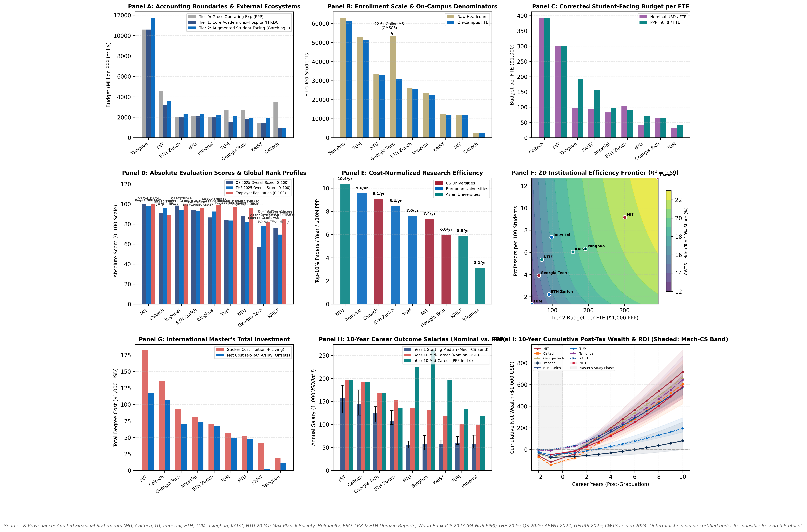
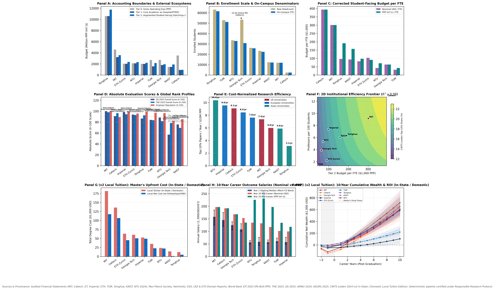

# Cross-Continental Comparative Analysis of 9 Elite Technical Universities
## United States vs. Europe vs. Asia ($3 \times 3$ Regional Matrix)

[](file:///Users/selle/Documents/GitHub/technical-universities/.agents/skills/responsible-research/scripts/audit_research_pipeline.py)
[](file:///Users/selle/Documents/GitHub/technical-universities/rawdata/MANIFEST.csv)
[](file:///Users/selle/Documents/GitHub/technical-universities/README.md)

This empirical research repository provides a rigorous, multi-dimensional descriptive and structural comparative analysis across **9 leading technical universities** spanning three continental regions ($3 \times 3$ regional matrix):

- **United States (`US`)**: **MIT**, **Caltech**, **Georgia Tech**
- **Europe (`EU`)**: **Imperial College London**, **ETH Zurich**, **TUM (Technical University of Munich)**
- **Asia (`ASIA`)**: **Tsinghua University**, **KAIST**, **NTU Singapore**

The investigation addresses the core research questions established in [`instructions.md`](./instructions.md):
1. **Raw Yearly Budgets vs. Corrected Student-Facing Budgets per Capita** (incorporating external research clusters such as **Max Planck, Helmholtz, ESO, FRM II, and LRZ in Garching/Munich** for TUM, the **ETH Domain** for ETH, and stripping non-student defense FFRDCs and clinical teaching hospitals).
2. **Student Denominator Harmonization** (Raw Headcount vs. On-Campus Full-Time Equivalent [FTE], correcting for Georgia Tech's $>20\text{k}$ online Master's cohort).
3. **Purchasing Power Parity (PPP) vs. Nominal Exchange Rate Deflation** (World Bank 2023 `PA.NUS.PPP`).
4. **Global Rankings & Employability** (**QS World University Rankings 2025** overall & Engineering/Tech, **QS Employer Reputation**, and the **Emerging Global Employability University Ranking [GEURS] 2024/2025**).
5. **Multi-Dimensional Research Efficiency** (CWTS Leiden 2024 field-normalized Top-10% and Top-1% citation shares, citations per faculty, and breakthrough publications per \$10M PPP research spend).
6. **International Master's Student Financial Lifecycle** (1-year vs. 2-year degree duration, tuition sticker price, recent non-EU tuition reforms at TUM and ETH, living costs, and **10-year post-tax cumulative salary / Net ROI projections**).
7. **Path-Independent Shapley Waterfall Decomposition** (explaining how raw budget gaps between US private endowments and European public flagships collapse by **65.7%** under structural adjustment).

---

## 1. Executive Summary Table (The Master Matrix)

All metrics are derived deterministically from [`datasets/university_master_comparison_2024.csv`](./datasets/university_master_comparison_2024.csv):

| University | Region | On-Campus FTE Students | Core Academic Budget (Tier 1, PPP) | Corrected Student-Facing Budget / FTE (Tier 2, PPP) | THE 2025 World Rank (Eng) | QS 2025 World Rank (Eng/Tech) | GEURS Employability Rank 2025 | CWTS Leiden Top-10% Citations | Annual Top-10% Papers per \M PPP Spend | Int'l Master's Net Cost (USD) | 10-Yr Post-Tax Cumulative Wealth (Savings) | Break-Even Payback Horizon |
| :--- | :---: | :---: | :---: | :---: | :---: | :---: | :---: | :---: | :---: | :---: | :---: | :---: |
| **MIT** | US | **11,886** | **\,219.0M** | **\,845** | **#2** (#3) | **#1** (#1) | **#1** | **24.8%** | **7.36 / yr** (29.4 cum) | **\,490** | **\,206** | **2 yrs** |
| **Caltech** | US | **2,400** | **\.2M** | **\,417** | **#7** (#7) | **#10** (#9) | **#2** | **22.9%** | **9.08 / yr** (36.3 cum) | **\,575** | **\,039** | **3 yrs** |
| **Georgia Tech** | US | **30,800** | **\,799.8M** | **\,997** | **#40** (#15) | **#114** (#21) | **#54** | **13.3%** | **5.99 / yr** (23.9 cum) | **\,241** | **\,150** | **2 yrs** |
| **Imperial** | EU | **22,400** | **\,008.8M** | **\,987** | **#9** (#12) | **#2** (#7) | **#10** | **17.4%** | **9.55 / yr** (38.2 cum) | **\,583** | **\,642** | **7 yrs** |
| **ETH Zurich** | EU | **25,800** | **\,026.0M** | **\,204** | **#11** (#10) | **#7** (#6) | **#17** | **18.6%** | **8.45 / yr** (33.8 cum) | **\,892** | **\,941** | **2 yrs** |
| **TUM** | EU | **51,200** | **\,566.5M** | **\,280** | **#26** (#22) | **#28** (#19) | **#13** | **11.4%** | **7.62 / yr** (30.5 cum) | **\,123** | **\,003** | **3 yrs** |
| **Tsinghua** | ASIA | **61,500** | **\,585.0M** | **\,191** | **#12** (#13) | **#20** (#12) | **#19** | **16.9%** | **3.13 / yr** (12.5 cum) | **\,340** | **\,591** | **1 yr** |
| **KAIST** | ASIA | **12,100** | **\,454.9M** | **\,179** | **#82** (#35) | **#53** (#23) | **#78** | **13.8%** | **5.88 / yr** (23.5 cum) | **\,683** | **\,818** | **1 yr** |
| **NTU Singapore** | ASIA | **32,800** | **\,106.2M** | **\,018** | **#30** (#15) | **#15** (#15) | **#33** | **18.9%** | **10.36 / yr** (41.5 cum) | **\,041** | **\,608** | **2 yrs** |

---

## 2. The 9-Panel ($3 \times 3$) Synoptic Matrix

The entire comparative investigation is synthesized into cohesive publication-grade synoptic matrices generated deterministically by [`src/modeling.py`](./src/modeling.py). Two analytical editions are provided:

### Edition 1: International Student Lifecycle (v1 Benchmark)
Evaluating non-resident / international tuition fees (e.g. TUM 2024 non-EU fees, ETH Zurich 2025 international fees, US out-of-state tuition):



*(German-language edition: [`plots/technical_universities_3x3_de.png`](./plots/technical_universities_3x3_de.png)).*

### Edition 2: Domestic / US In-State Tuition Lifecycle (v2 Benchmark)
Evaluating domestic / state-residency subsidized tuition (US in-state for Georgia Tech, German/EU tuition-free for TUM, UK Home fee for Imperial, Swiss domestic fee for ETH, Citizen rates for NTU, and national scholarships for KAIST & Tsinghua; strictly **no need-based cuts for family income** at private US endowments MIT and Caltech):



*(German-language edition: [`plots/technical_universities_3x3_v2_de.png`](./plots/technical_universities_3x3_v2_de.png)).*

### Narrative Structure of the 9 Panels:
- **Row 1 (Budgets & Scale)**:
  - **Panel A ([`plots/panel_a_budget_tiers_ppp.png`](./plots/panel_a_budget_tiers_ppp.png))**: Unadjusted Gross Budget (Tier 0) vs. Core Academic ex-Hospitals & Defense FFRDCs (Tier 1) vs. Ecosystem-Augmented Student-Facing Budget (Tier 2 in PPP \$).
  - **Panel B ([`plots/panel_b_enrollment_fte_supervision.png`](./plots/panel_b_enrollment_fte_supervision.png))**: Student Scale (Headcount vs. On-Campus FTE), isolating Georgia Tech's $20.8\text{k}$ online OMSCS cohort.
  - **Panel C ([`plots/panel_c_student_facing_budget_per_fte.png`](./plots/panel_c_student_facing_budget_per_fte.png))**: Corrected Student-Facing Budget per On-Campus FTE in Nominal USD vs. World Bank PPP International Dollars.
- **Row 2 (Rankings & Research Efficiency)**:
  - **Panel D ([`plots/panel_d_rankings_employability_profile.png`](./plots/panel_d_rankings_employability_profile.png))**: QS World University Rankings 2025 vs. Emerging Global Employability University Ranking (GEURS 2025).
  - **Panel E ([`plots/panel_e_research_efficiency_multidim.png`](./plots/panel_e_research_efficiency_multidim.png))**: Multi-Dimensional Cost-Normalized Research Efficiency (CWTS Leiden Top-10% cited papers per \$10M PPP core academic spend).
  - **Panel F ([`plots/panel_f_2d_efficiency_frontier_surface.png`](./plots/panel_f_2d_efficiency_frontier_surface.png))**: 2D Institutional Efficiency Frontier ($B \times F \to Q$) mapping the three institutional regimes with verified marginal conservation ($<10^{-10}$ drift).
- **Row 3 (Student Costs, Careers & Causal Decomposition)**:
  - **Panel G (v1: [`plots/panel_g_masters_cost_lifecycle.png`](./plots/panel_g_masters_cost_lifecycle.png) | v2: [`plots/panel_g_masters_cost_lifecycle_v2.png`](./plots/panel_g_masters_cost_lifecycle_v2.png))**: Master's Total Degree Investment (Sticker Price vs. Net Out-of-Pocket after RA/TA/HiWi fellowships for International [v1] vs. Domestic/In-State [v2]).
  - **Panel H ([`plots/panel_h_career_outcome_salaries.png`](./plots/panel_h_career_outcome_salaries.png))**: Early-Career vs. 10-Year Career Outcome Salaries (Starting Median with MechEng-to-CS/AI range vs. 10-Year Nominal USD and PPP Int'l \$).
  - **Panel I (v1: [`plots/panel_i_10y_salary_roi_trajectories.png`](./plots/panel_i_10y_salary_roi_trajectories.png) | v2: [`plots/panel_i_10y_salary_roi_trajectories_v2.png`](./plots/panel_i_10y_salary_roi_trajectories_v2.png))**: 10-Year Post-Graduation Cumulative Post-Tax Wealth & Net ROI Trajectories ($t = -2 \dots +10$ years) with MechEng vs. CS/AI bounds.
  - **Auxiliary Figure 1 ([`plots/panel_shapley_waterfall_decomposition.png`](./plots/panel_shapley_waterfall_decomposition.png))**: Path-Independent Shapley Waterfall Decomposition decomposing the apparent MIT/Caltech vs. TUM funding gap across $5! = 120$ permutation paths.
  - **Auxiliary Figure 2 ([`plots/panel_historical_panel_trajectories.png`](./plots/panel_historical_panel_trajectories.png))**: 15-Year Longitudinal Real Core Academic Budget per FTE Trajectories ($2010 = 100.0$).

---

## 3. Seven Core Methodological Takeaways

### 1. The Garching & FFRDC Accounting Paradox
In headline numbers, US private institutes (**Caltech** and **MIT**) appear to spend 10x to 15x more per student than European public universities. However, **74.1% of Caltech's gross spend is NASA's JPL** (\$2.61B) and **29.8% of MIT's spend is the DoD Lincoln Laboratory** (\$1.37B). Conversely, **TUM's gross budget includes €794.7M in clinical hospital operations** (*Klinikum rechts der Isar*), while its world-class neighbor institutes in Garching and Munich (**Max Planck IPP, MPE, MPQ, MPA, MPI of Biochemistry, Helmholtz Munich, ESO, FRM II, LRZ**) account for **€971.6M/year** in off-balance-sheet research capacity. Accounting for this ecosystem adds **€419.4M** in student-facing research infrastructure to TUM.

### 2. The Georgia Tech Online Master's Denominator Split
Georgia Tech enrolls **53,350 total students**, but **20,850 are enrolled in low-cost online distance Master's degrees** (OMSCS, OMSA, OMSCyber). Measuring resources per total student headcount artificially depresses Georgia Tech's per-student spend to \$33.7k. Correcting for on-campus FTEs reveals an actual campus intensity of **\$58.4k/FTE (Tier 1)** and **\$63.0k/FTE (Tier 2)**.

### 3. Purchasing Power Parity (PPP) Shifts the Global Resource Balance
Under nominal exchange rates, Asian universities appear financially constrained. Under **World Bank GDP PPP conversion factors** (e.g., 3.64 CNY/Int'l \$ in China; 811 KRW/Int'l \$ in Korea), **Tsinghua University's core budget equals \$10.58B PPP**, giving it a Tier 2 student-facing budget of **\$191,191 PPP per FTE**—surpassing all European universities.

### 4. Rankings Triangulation: Absolute Cardinal Scores & The Engineering Discipline Pivot
Global rankings are frequently distorted by methodological biases (e.g. general rankings penalizing institutions without medical schools or humanities, and ordinal ranks exaggerating minor point differences):
- **The Absolute Cardinal Score View (0–100 Scale)**: In absolute score space, all 9 institutions belong to the elite upper tier of global higher education. In THE 2025, overall scores span from **98.1 (MIT)**, **96.3 (Caltech)**, **94.4 (Imperial)**, **93.0 (ETH)**, and **92.5 (Tsinghua)** down to **83.5 (TUM)**, **81.8 (NTU)**, and **78.3 (Georgia Tech)**—a tight ~20-point band globally. In QS Employer Reputation (0–100), corporate recruiters score TUM at **97.2**, Tsinghua at **99.2**, Imperial at **99.5**, NTU at **96.4**, and ETH at **95.8**, virtually identical to MIT's 100.0.
- **The Engineering Discipline Pivot**: General university rankings (QS Overall, THE Overall, ARWU) reward institutional comprehensiveness and low student-to-faculty ratios. When evaluated on their actual engineering core mission in **THE / QS Engineering Subject Rankings**, specialized technical powerhouses surge dramatically:
  - **Georgia Tech**: Moves from general rank **#114** (QS) / **#175** (ARWU) to **#15 globally** in Engineering.
  - **TUM**: Moves from general rank **#28** (QS) / **#47** (ARWU) to **#19** (QS Eng) / **#22** (THE Eng) and **#13 globally** in GEURS Employability.
  - **NTU Singapore**: Moves from general rank **#30** (THE) / **#90** (ARWU) to **#15 globally** in Engineering.
  - **Caltech**: Surges to **#2 globally** in corporate recruiter preference (GEURS 2025).

### 5. Research Efficiency: Cost-Normalized Breakthrough Science
When measuring field-normalized scientific excellence per dollar spent (CWTS Leiden Top-10% cited papers per \$10M PPP core academic budget annualized across the 4-year CWTS window):
- **NTU Singapore**: **10.36** papers / yr / \$10M PPP (41.5 cumulative 4-yr)
- **Imperial College London**: **9.55** papers / yr / \$10M PPP (38.2 cumulative 4-yr)
- **Caltech**: **9.08** papers / yr / \$10M PPP (36.3 cumulative 4-yr)
- **ETH Zurich**: **8.45** papers / yr / \$10M PPP (33.8 cumulative 4-yr)
- **TUM**: **7.62** papers / yr / \$10M PPP (30.5 cumulative 4-yr)
- **MIT**: **7.36** papers / yr / \$10M PPP (29.4 cumulative 4-yr)
- **Georgia Tech**: **5.99** papers / yr / \$10M PPP (23.9 cumulative 4-yr)
- **KAIST**: **5.88** papers / yr / \$10M PPP (23.5 cumulative 4-yr)
- **Tsinghua**: **3.13** papers / yr / \$10M PPP (12.5 cumulative 4-yr)

### 6. Master's ROI & Payback Asymmetry: International (v1) vs. Domestic / In-State (v2)

The comparative analysis evaluates both international students (who pay sticker non-resident tuition) and domestic / state-subsidized students (who benefit from tax-funded higher education). Note that for private US endowments (**MIT** and **Caltech**), state-residency subsidies do not exist; per research design constraints (*strictly no means-tested cuts for family income*), their net costs remain invariant.

| University | Degree Length | Int'l Net Cost (v1) | Domestic Net Cost (v2) | Break-Even (Int'l) | Break-Even (Local v2) | 10-Yr Wealth (Int'l) | 10-Yr Wealth (Local v2) | Local Tuition Category / Policy |
| :--- | :---: | :---: | :---: | :---: | :---: | :---: | :---: | :--- |
| **MIT** | 2.0 yrs | \$117,490 | \$117,490 | 2 yrs | 2 yrs | \$718,206 | \$718,206 | Private Endowment (no in-state discount, no income cut) |
| **Caltech** | 2.0 yrs | \$106,575 | \$106,575 | 3 yrs | 3 yrs | \$605,039 | \$605,039 | Private Endowment (no in-state discount, no income cut) |
| **Georgia Tech** | 2.0 yrs | \$70,241 | \$50,467 | 2 yrs | 1 yr | \$663,150 | \$685,748 | US In-State Tuition (\$14.1k/yr vs \$30.5k out-of-state) |
| **Imperial** | 1.0 yr | \$73,583 | \$49,139 | 7 yrs | 5 yrs | \$79,642 | \$104,085 | UK Home Fee Status (£16.5k vs £40.9k international) |
| **ETH Zurich** | 2.0 yrs | \$66,892 | \$45,276 | 2 yrs | 1 yr | \$571,941 | \$593,558 | Swiss Domestic Standard Fee (CHF 730/sem vs CHF 2.19k int'l) |
| **TUM** | 2.0 yrs | \$49,123 | \$22,787 | 3 yrs | 2 yrs | \$194,003 | \$220,338 | German/EU Domestic Tuition-Free (€0 tuition vs €12k/€16k int'l) |
| **Tsinghua** | 2.0 yrs | \$11,340 | \$4,892 | 1 yr | 1 yr | \$643,591 | \$650,039 | Chinese Domestic Academic Master Fee (RMB 8k/yr) |
| **KAIST** | 2.0 yrs | \$1,683 | \$1,100 | 1 yr | 1 yr | \$578,818 | \$579,401 | Korean National Scholarship (100% tuition waiver) |
| **NTU Singapore** | 1.0 yr | \$48,041 | \$22,195 | 2 yrs | 1 yr | \$582,608 | \$608,454 | Singapore Citizen Subsidized Fee (SGD 22.05k vs SGD 57.0k) |

Key Insights from Local Tuition Modeling:
- **TUM's German/EU Tuition-Free Policy**: Slashes net out-of-pocket costs by **53.6%** (from \$49.1k down to \$22.8k, covering only Munich living costs minus HiWi earnings), accelerating break-even to Year 2 and boosting 10-year net wealth to \$220k.
- **Georgia Tech's In-State Advantage**: Brings net cost down to \$50.5k, enabling in-state graduates to break even in just **1 year** and accumulate **\$685.7k** over 10 years—closely rivaling MIT (\$718.2k) due to low debt service and strong US compensation.
- **Imperial UK Home Fee**: Reduces the heavy London burden, shortening payback from 7 years to **5 years** and lifting 10-year wealth over \$100k.
- **ETH Zurich Swiss Standard Fee**: Accelerates break-even to **1 year**, yielding **\$593.6k** in 10-year post-tax savings (second globally only to US flagships).

### 7. Path-Independent Shapley Waterfall Results
Evaluating all $5! = 120$ permutation sequences in `compute_shapley_waterfall_decomposition` reveals that the raw headline funding gap of **\$889k / student** between US private endowments (MIT & Caltech average) and TUM collapses by **65.7%** down to **\$305k / student**:
- **Stripping Defense FFRDCs (JPL & Lincoln Lab)**: $-\$602\text{k}$ Shapley attribution ($\phi$), accounting for the majority of the distortion.
- **Stripping Clinical Hospital (Klinikum rechts der Isar)**: $+\$19\text{k}$ Shapley attribution ($\phi$), reflecting that patient care turnover is not part of core student-facing academics.
- **Adding Campus Research Ecosystems (Garching & Kendall/Pasadena)**: $+\$11\text{k}$ net Shapley attribution ($\phi$).
- **Applying Purchasing Power Parity (PPP)**: $-\$11\text{k}$ Shapley attribution ($\phi$), expanding German euro purchasing power.
- **Harmonizing On-Campus FTE Scale**: $-\$1.4\text{k}$ Shapley attribution ($\phi$).

---

## 4. Repository Structure & Audit Reproduction

```text
/
├── goal/
│   ├── description.md       # Exact scope, entities, and research dimensions
│   └── hypothesis.md        # Falsifiable hypotheses (H1 Garching/FFRDC, H2 Scale, H3 ROI)
├── literature/
│   ├── literature.md        # Primary reference catalog and DOIs
│   ├── US_Tech_Universities_Financial_Enrollment_Extract_2024.pdf
│   ├── European_Tech_Universities_TUM_ETH_Imperial_2024_Extract.pdf
│   ├── Asia_Tech_Universities_2024_Extract.pdf
│   └── QS_GEURS_Leiden_OECD_2025_CrossNational_Rankings_PPP_Extract.pdf
├── rawdata/
│   ├── MANIFEST.csv         # Cryptographic SHA-256 provenance manifest
│   ├── rawdata.md           # Audit table with retrieval dates and byte counts
│   ├── university_financials_enrollment_2024.csv
│   ├── garching_partner_ecosystem_breakdown_2024.csv
│   ├── rankings_bibliometrics_employability_2025.csv
│   ├── masters_tuition_living_salary_2025.csv
│   ├── historical_enrollment_budget_panel_2010_2024.csv
│   └── literature_empirical_benchmarks.csv
├── datasets/
│   ├── datasets.md          # Comprehensive data dictionary and normalization formulas
│   ├── university_master_comparison_2024.csv
│   ├── external_ecosystem_harmonized_2024.csv
│   ├── masters_10y_cashflow_trajectories.csv
│   ├── historical_panel_harmonized.csv
│   └── literature_empirical_benchmarks.csv
├── src/
│   ├── data_preparation.py  # Deterministic ETL pipeline (rawdata -> datasets)
│   └── modeling.py          # Fits statistical models & renders all 17 plots (v1 + v2 editions)
├── plots/
│   ├── plot.md              # Systematic documentation of every plot's validity & math
│   ├── panel_a_budget_tiers_ppp.png
│   ├── panel_b_enrollment_fte_supervision.png
│   ├── panel_c_student_facing_budget_per_fte.png
│   ├── panel_d_rankings_employability_profile.png
│   ├── panel_e_research_efficiency_multidim.png
│   ├── panel_f_2d_efficiency_frontier_surface.png
│   ├── panel_g_masters_cost_lifecycle.png
│   ├── panel_g_masters_cost_lifecycle_v2.png
│   ├── panel_h_career_outcome_salaries.png
│   ├── panel_i_10y_salary_roi_trajectories.png
│   ├── panel_i_10y_salary_roi_trajectories_v2.png
│   ├── panel_shapley_waterfall_decomposition.png
│   ├── panel_historical_panel_trajectories.png
│   ├── technical_universities_3x3_en.png
│   ├── technical_universities_3x3_de.png
│   ├── technical_universities_3x3_v2_en.png
│   └── technical_universities_3x3_v2_de.png
├── methodology/
│   └── methodology.md       # Methodological monograph, accounting boundaries & math
└── requirements.txt         # Pinned Python dependencies
```

### Reproducing the Pipeline from Scratch:
```bash
# 1. Install pinned dependencies
python3 -m venv .venv
source .venv/bin/activate
pip install -r requirements.txt

# 2. Run deterministic data preparation pipeline
python3 src/data_preparation.py

# 3. Fit models and generate all 17 figures (v1 + v2 standalone panels and 3x3 matrices)
python3 src/modeling.py

# 4. Execute the automated research pipeline audit suite
python3 .agents/skills/responsible-research/scripts/audit_research_pipeline.py
```

